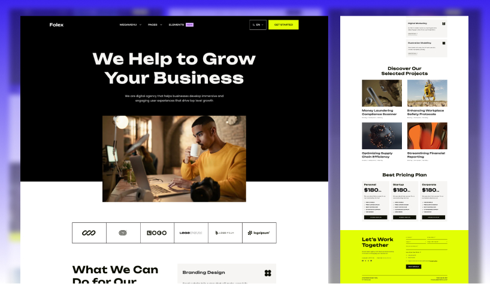

> ⭐️ Love this theme? Star it to support our work!

# 🚀 Folex Lite Astro — Sanity CMS Edition

**Folex Lite** is a lightweight, free version of the premium [Folex Astro Theme](https://getastrothemes.com/astro-themes/folex/), designed for fast, SEO-friendly startup and digital agency websites.

This branch (`sanity-cms`) is the **Sanity CMS edition**. It looks exactly like the original theme, but every text, image, menu, page and portfolio project is edited in **Sanity Studio**, a visual editor that runs in your browser. You don't need to touch code to change your content.

> ⚡ Built with Astro 7, Tailwind CSS 4 and Sanity. The live website is plain static files, so it stays fast and SEO friendly.



## 📚 Contents

- [Which edition should I use?](#-which-edition-should-i-use)
- [What is Sanity? (short glossary)](#-what-is-sanity-short-glossary)
- [Features](#-features)
- [Prerequisites](#-prerequisites)
- [Quick start (about 5 minutes)](#-quick-start-about-5-minutes)
- [Manual setup (without `npm run setup`)](#-manual-setup-without-npm-run-setup)
- [Environment variables (`.env`)](#-environment-variables-env)
- [Local development](#-local-development)
- [Using Sanity Studio](#-using-sanity-studio)
- [Visual editing and preview](#-visual-editing-and-preview)
- [Pages and sections](#-pages-and-sections)
- [Languages](#-languages)
- [Images and media](#-images-and-media)
- [SEO](#-seo)
- [Contact form](#-contact-form)
- [What stays in code](#-what-stays-in-code)
- [Deploy the website](#-deploy-the-website)
- [Rebuild automatically when you publish](#-rebuild-automatically-when-you-publish)
- [Put the Studio online](#-put-the-studio-online)
- [Optional: an online preview server](#-optional-an-online-preview-server)
- [Sanity free plan: limits and privacy](#-sanity-free-plan-limits-and-privacy)
- [Troubleshooting](#-troubleshooting)
- [Updating the theme](#-updating-the-theme)
- [Commands](#-commands)
- [Project structure](#-project-structure)

## 🔀 Which edition should I use?

Folex Lite comes in three editions with the same design and pages. Each one lives on its own branch of the same GitHub repository and has its own setup guide:

| Edition                       | Branch                                                                             | You edit content in…                                        | Best for                                                        | Setup guide                                                                                   |
| ----------------------------- | ---------------------------------------------------------------------------------- | ----------------------------------------------------------- | --------------------------------------------------------------- | --------------------------------------------------------------------------------------------- |
| **Original**                  | [`main`](https://github.com/getastrothemes/folex-lite-astro/tree/main)             | Markdown, JSON and TOML files in your code editor           | Developers and people who like editing files                    | [Original README](https://github.com/getastrothemes/folex-lite-astro/blob/main/readme.md)     |
| **Tina CMS edition**          | [`tina-cms`](https://github.com/getastrothemes/folex-lite-astro/tree/tina-cms)     | A visual editor on top of the same Git-based Markdown files | People who want visual editing but keep content as files in Git | [Tina CMS README](https://github.com/getastrothemes/folex-lite-astro/blob/tina-cms/readme.md) |
| **Sanity CMS edition** (this) | [`sanity-cms`](https://github.com/getastrothemes/folex-lite-astro/tree/sanity-cms) | Sanity Studio, a visual editor in the browser               | Clients, marketing teams and anyone who doesn't edit code       | This file                                                                                     |

### Get or switch an edition

```bash
# Start with the Sanity CMS edition
git clone --branch sanity-cms https://github.com/getastrothemes/folex-lite-astro.git
cd folex-lite-astro

# Already cloned the repository? Switch between editions:
git switch sanity-cms   # Sanity CMS edition
git switch tina-cms     # Tina CMS edition
git switch main         # Original edition
npm install             # after every switch, the editions use different packages
```

Good to know before you switch:

- **Content does not move automatically into or out of Sanity.** The original and Tina CMS editions store content in the same Markdown files, but this edition stores it in Sanity. Edits you made to Markdown files are not imported into Sanity, and content you write in Sanity does not appear in the Markdown files.
- The **demo content** of this edition (`sanity/seed/demo-content.json`) was generated from the Markdown content of the `main` branch by `scripts/sanity/build-seed.mjs`. That's why every edition shows the same demo website.
- Commit or stash your own changes before `git switch`; Git may refuse to switch otherwise.

## 🧠 What is Sanity? (short glossary)

[Sanity](https://www.sanity.io/) is a hosted content platform (a "headless CMS"). Your content is stored in Sanity's cloud, and this theme reads it when it builds the website. The free plan is enough for this theme.

| Word                            | What it means                                                                                                                                                                                   |
| ------------------------------- | ----------------------------------------------------------------------------------------------------------------------------------------------------------------------------------------------- |
| **Sanity Studio**               | The editing app. It runs on your computer (`http://localhost:3333`) and, once deployed, on an address like `https://your-name.sanity.studio`. The Studio's code is part of this repository.     |
| **Project**                     | Your space at Sanity. It has a **project ID** (for example `abc123de`) that the website and the Studio use to find your content. Manage it at [sanity.io/manage](https://www.sanity.io/manage). |
| **Dataset**                     | A content database inside a project. This theme uses one called `production`.                                                                                                                   |
| **Document**                    | One piece of content: a page, a portfolio project, a service, the site settings…                                                                                                                |
| **Draft vs. published**         | Every change you type is saved automatically as a **draft**. Visitors only see a change after you click **Publish**.                                                                            |
| **Singleton**                   | A document that exists only once, like "Site settings" or the "Home page" of a language. You can't create a second one or delete it by accident.                                                |
| **CORS origin**                 | A website address that is allowed to talk to your Sanity project from a browser. The Studio and the preview need their addresses on this list.                                                  |
| **API token**                   | A secret password for programs. This theme only uses a read-only (**Viewer**) token, and only for previewing drafts. Never share it or put it in public code.                                   |
| **Presentation / Live preview** | A Studio tool (called **Live preview** in this theme) that shows your website next to the editor. You can click any text on the page to edit it. This is also called **visual editing**.        |
| **Webhook**                     | A message Sanity sends to another service when you publish, for example "rebuild my website now".                                                                                               |
| **GROQ**                        | Sanity's query language. Only developers need it: the website's queries live in `src/lib/sanity/queries.ts`. Editors never have to write GROQ.                                                  |

## ✨ Features

- ✅ Same design as Folex Lite: Startup / Agency homepage, portfolio, pricing, legal pages, 404 page
- ✅ Every text, image, button, menu item and form field is editable in Sanity Studio
- ✅ Page builder: add, remove, reorder and hide sections on the home page and on any page
- ✅ Create new pages yourself and add them to the menu
- ✅ Live preview with click-to-edit (visual editing) and draft previews
- ✅ Multilingual: English and French out of the box, with one home page, menu and footer per language
- ✅ Static production build: fast, secure, no server needed, no token on your host
- ✅ Images served from Sanity's image CDN with automatic formats, responsive sizes and hotspot cropping
- ✅ SEO: site-wide defaults plus per-page title, description, social sharing image and "hide from search engines"
- ✅ Contact form with FormSubmit, Formspree or Netlify Forms, with fields you edit in the Studio
- ✅ Works without Sanity too: with no project ID the site builds from the bundled demo content
- ✅ One-command setup: `npm run setup` creates the project, `.env`, CORS origins, preview token and demo content

### Content you can edit in the Studio

| Studio menu                              | What it holds                                                                                                                                                                                                                              |
| ---------------------------------------- | ------------------------------------------------------------------------------------------------------------------------------------------------------------------------------------------------------------------------------------------ |
| **Site settings**                        | Site name, tagline, default description, logos (for light and dark backgrounds), logo text and size, contact info (address, email, phone), social links, default SEO, contact form service, sticky header, copyright on/off, 404 page text |
| **Home page** (per language)             | Title, SEO and the home page sections                                                                                                                                                                                                      |
| **Pages** (per language)                 | Title, URL slug, optional cover image, page text (rich text), optional sections, SEO                                                                                                                                                       |
| **Portfolio projects**                   | Name, URL slug, date, order, categories, short summary, cover image, gallery, project details, project story (rich text), SEO                                                                                                              |
| **Services**                             | Name, description, order                                                                                                                                                                                                                   |
| **Navigation menu** (per language)       | Menu items with up to 3 levels and optional badges, header button, side panel (text and button)                                                                                                                                            |
| **Footer & contact form** (per language) | Big footer heading and text, copyright line, and the contact form (email subject, fields, note, send button, success and error messages)                                                                                                   |

**Page sections** (the building blocks of the home page and of pages):

| Section          | What it shows                                                                                           |
| ---------------- | ------------------------------------------------------------------------------------------------------- |
| **Banner**       | Big heading (three sizes), text, image and button                                                       |
| **Clients**      | Row of client logos, light or dark, 4 or 6 per row                                                      |
| **Services**     | Services as an accordion, vertical or horizontal; pick services or show all of the language             |
| **Portfolio**    | Project cards in a grid or masonry layout, light or dark; pick projects or show the latest ones; button |
| **Pricing**      | Pricing plans with price, features and a button                                                         |
| **Text content** | A heading and rich text (like the legal pages)                                                          |

## 🧰 Prerequisites

- **Node.js 22.12 or newer.** Check with `node -v`. Download the LTS version from [nodejs.org](https://nodejs.org/). (`npm run setup` stops with a clear message if your version is too old.)
- **Git.** Check with `git --version`. Download from [git-scm.com](https://git-scm.com/).
- **A free Sanity account.** You can create it during `npm run setup` (log in with Google, GitHub or email) or beforehand at [sanity.io](https://www.sanity.io/).
- A terminal (Terminal on macOS, PowerShell on Windows) and a code editor such as VS Code.

## ⚡ Quick start (about 5 minutes)

Run these commands in a terminal:

```bash
git clone --branch sanity-cms https://github.com/getastrothemes/folex-lite-astro.git
cd folex-lite-astro
npm install
npm run setup
npm run dev:all
```

What happens:

1. `npm install` downloads everything the website and the Studio need.
2. `npm run setup` walks you through the Sanity setup. It:
   - checks your Node.js version,
   - opens your browser so you can log in to Sanity (or create a free account),
   - asks whether to **create a new project** (recommended) or use one you already have,
   - creates the public `production` dataset,
   - writes your project ID and settings into a new `.env` file,
   - allows `http://localhost:4321` (website) and `http://localhost:3333` (Studio) in your project's CORS origins,
   - creates a read-only **Viewer** token for previews and saves it in `.env` without showing it,
   - asks whether to turn on preview mode for local development (recommended: yes), unless `.env` already sets `SANITY_VISUAL_EDITING`,
   - imports the **demo content** (35 documents plus images) so your site looks like the theme demo. New projects get the demo content by default. For an existing project it asks first and only adds documents that don't exist yet.
3. `npm run dev:all` starts the website and the Studio together. Each line in the terminal starts with `[site]` or `[studio]`. Press `Ctrl + C` to stop both.

Now open:

- **Website:** [http://localhost:4321](http://localhost:4321) — the theme with your Sanity content.
- **Studio:** [http://localhost:3333](http://localhost:3333) — log in with the same Sanity account you used during setup.

> 💡 Every setup step is safe to run again. Run `npm run setup -- --help` to see all options, or `npm run setup -- --dry-run` to see what it would do without changing anything.

Useful setup options (add them after `--`):

| Option                | What it does                                                                      |
| --------------------- | --------------------------------------------------------------------------------- |
| `--project <id>`      | Use an existing project instead of creating one                                   |
| `--name <name>`       | Name for a new project (default: "Folex website")                                 |
| `--organization <id>` | Organization for a new project, if your account has several                       |
| `--dataset <name>`    | Dataset name (default: `production`)                                              |
| `--cors-origin <url>` | Also allow this address, for example your online preview server (can be repeated) |
| `--yes` / `-y`        | Don't ask questions, use the defaults                                             |
| `--skip-import`       | Don't import the demo content                                                     |
| `--skip-token`        | Don't create the preview token                                                    |
| `--skip-cors`         | Don't add CORS origins                                                            |
| `--dry-run`           | Only show what would happen, nothing is changed and no login is needed            |

Example: `npm run setup -- --project abc123de --yes`

> ⚠️ With `--yes` on an **existing** project, the demo content is **not** imported (so nothing of yours is overwritten). Run `npm run import-demo -- --missing` afterwards if you want it.

### Just want to look around without Sanity?

Run `npm install` and `npm run dev` without a `.env` file. The website then shows the bundled demo content, and the terminal prints a yellow notice: `[sanity] PUBLIC_SANITY_PROJECT_ID is not set. Showing the bundled demo content.` The Studio needs a project, so `npm run studio` won't work until you run `npm run setup`.

## 🛠 Manual setup (without `npm run setup`)

Prefer to click through the dashboards yourself? This does the same as `npm run setup`.

1. **Create the project.** Go to [sanity.io/manage](https://www.sanity.io/manage) and log in. Click **Create new project** (on a new account, follow the steps to create an organization first). Give it a name. Copy the **Project ID** shown on the project page.
   - New organizations may start with a free trial of a paid plan and drop to the Free plan when it ends. This theme uses no paid feature.
2. **Create the dataset.** In your project, open **Datasets**. If there is no `production` dataset, click **Add dataset**, name it `production` and choose **Public** visibility.
3. **Add CORS origins.** Open **API** → **CORS origins** → **Add CORS origin**. Add `http://localhost:3333` and `http://localhost:4321`, and tick **Allow credentials** for both.
4. **Create the preview token (optional, only for drafts and click-to-edit).** Open **API** → **Tokens** → **Add API token**. Name it for example "Website preview", choose **Viewer** permissions and save. Copy the token right away: Sanity only shows it once.
5. **Create `.env`.** Copy `.env.example` to a new file named `.env` in the project root and fill it in (see the table below):

   ```bash
   cp .env.example .env    # Windows PowerShell: Copy-Item .env.example .env
   ```

   Set `PUBLIC_SANITY_PROJECT_ID` and `SANITY_STUDIO_PROJECT_ID` to your project ID. For Live preview on your computer, also paste the token into `SANITY_API_READ_TOKEN` and change `SANITY_VISUAL_EDITING=false` to `SANITY_VISUAL_EDITING=true`.

6. **Log in the Sanity CLI** (the command-line tool that comes with `npm install`): `npx sanity login`.
7. **Import the demo content (optional):** `npm run import-demo`.
8. **Start everything:** `npm run dev:all`.

## 🔐 Environment variables (`.env`)

All settings live in one `.env` file in the project root. It is listed in `.gitignore`, so it is never committed. `.env.example` explains every value. Restart `npm run dev` / `npm run studio` after changing `.env`.

- **Public** values end up in the website's or Studio's code, so anyone can see them. That is fine: a project ID is not a secret.
- **Secret** values must stay private. Never put them in client-side code, screenshots, chat messages or on your static host.

| Variable                    | Public / secret | Default                 | Used by                                 | What it does                                                                                                                                              |
| --------------------------- | --------------- | ----------------------- | --------------------------------------- | --------------------------------------------------------------------------------------------------------------------------------------------------------- |
| `PUBLIC_SANITY_PROJECT_ID`  | Public          | _(empty)_               | Website                                 | Your project ID. Empty = the site uses the bundled demo content.                                                                                          |
| `PUBLIC_SANITY_DATASET`     | Public          | `production`            | Website                                 | The dataset to read from.                                                                                                                                 |
| `PUBLIC_SANITY_API_VERSION` | Public          | `2025-02-19`            | Website                                 | Sanity API date version. You normally don't change it.                                                                                                    |
| `PUBLIC_SANITY_STUDIO_URL`  | Public          | `http://localhost:3333` | Website (preview)                       | Where your Studio runs. Used by the "Open Studio" link and click-to-edit. After deploying the Studio, set it to e.g. `https://your-name.sanity.studio`.   |
| `SANITY_API_READ_TOKEN`     | **Secret**      | _(empty)_               | Website (preview only)                  | Viewer token used only by the preview server to read drafts. Never set it on your static host.                                                            |
| `SANITY_VISUAL_EDITING`     | Setting         | `false`                 | Website (`npm run dev`, preview server) | `true` = `npm run dev` and the preview server can show drafts and click-to-edit. `npm run build` always makes the normal static site, whatever this says. |
| `SANITY_STUDIO_PROJECT_ID`  | Public          | _(empty)_               | Studio and CLI                          | Same value as `PUBLIC_SANITY_PROJECT_ID`. The Studio only reads variables that start with `SANITY_STUDIO_`.                                               |
| `SANITY_STUDIO_DATASET`     | Public          | `production`            | Studio and CLI                          | Same value as `PUBLIC_SANITY_DATASET`.                                                                                                                    |
| `SANITY_STUDIO_PREVIEW_URL` | Public          | `http://localhost:4321` | Studio                                  | The website address the **Live preview** tool shows. Built into the Studio, so redeploy the Studio after changing it.                                     |
| `SANITY_STUDIO_HOSTNAME`    | Public          | _(empty)_               | `npm run studio:deploy`                 | Optional. The `*.sanity.studio` name to deploy to, e.g. `my-agency` → `https://my-agency.sanity.studio`. Not in `.env.example`; add it if you want.       |
| `SANITY_STUDIO_APP_ID`      | Public          | _(empty)_               | `npm run studio:deploy`                 | Optional. The app ID the Sanity CLI shows after your first Studio deploy, so later deploys update the same Studio. Not in `.env.example`.                 |

## 💻 Local development

| You want to…                          | Run               | Then open                                                                           |
| ------------------------------------- | ----------------- | ----------------------------------------------------------------------------------- |
| Work on the site and content together | `npm run dev:all` | [localhost:4321](http://localhost:4321) and [localhost:3333](http://localhost:3333) |
| Only the website                      | `npm run dev`     | [localhost:4321](http://localhost:4321)                                             |
| Only the Studio                       | `npm run studio`  | [localhost:3333](http://localhost:3333)                                             |
| Check the production (static) build   | `npm run preview` | the address it prints                                                               |

- The dev server reads content from Sanity on every page load, so a reload shows what you just **published**. With `SANITY_VISUAL_EDITING=true` and the token in `.env`, the Studio's **Live preview** also shows your **drafts**.
- Published changes can take up to about a minute to appear, because Sanity serves published content through its API CDN (a global cache). Drafts in Live preview show up right away.

## 🖊 Using Sanity Studio

Open the Studio ([localhost:3333](http://localhost:3333) or your deployed `*.sanity.studio` address) and log in with your Sanity account. Other people can log in once you invite them at [sanity.io/manage](https://www.sanity.io/manage) → your project → **Members**.

At the top you'll find the tools:

- **Content** — the list of everything you can edit (see the table in [Features](#content-you-can-edit-in-the-studio)).
- **Live preview** — your website next to the editor, with click-to-edit.
- **Vision** — a GROQ query playground for developers. It only appears while running the Studio locally.
- **Releases** may also appear while your project is on a paid plan or trial. The theme doesn't need it.

### Editing and publishing

1. Open a document, for example **Content → Site settings**. Fields are grouped in tabs such as **General**, **Logo**, **Contact & social**, **SEO** and **Settings**. Every field has a short help text.
2. Type your change. It is saved automatically as a **draft** (you'll see "Draft" or "Edited" at the top). Visitors don't see drafts.
3. Click **Publish** at the bottom right. Required fields that are still empty are marked red and block publishing until you fill them in. Yellow warnings (for example a missing alt text or a too long description) don't block publishing.
4. Your change is now published. On the local dev server it shows after a reload (up to about a minute). Your live, static website shows it after the next rebuild — see [Rebuild automatically when you publish](#-rebuild-automatically-when-you-publish).

Other useful buttons in the menu next to **Publish**: **Discard changes** (throw away the draft) and the history icon at the top right (see and restore earlier versions).

## 👀 Visual editing and preview

### Live preview in the Studio

1. In the Studio, click **Live preview** at the top.
2. Your website opens next to the editor, showing your **drafts**.
3. Make sure **Edit** mode is on in the preview toolbar, then click any text or section on the page. The Studio opens the exact field.
4. Type: the preview updates by itself after a moment (the page reloads).
5. Use the address bar inside the preview to go to other pages. The panel above the editor shows which documents are used on the current page.
6. When it looks right, click **Publish**.

### Preview in a normal browser tab

When you open the preview website in a normal tab while preview mode is on (for example by opening the preview address in a new tab), a small bar appears at the bottom of the page: **"Preview mode: showing unpublished changes · Open Studio · Exit preview"**. Click **Exit preview** to see the site as visitors see it.

### How it works (in short)

- Locally, `SANITY_VISUAL_EDITING=true` in `.env` (set by `npm run setup`) makes `npm run dev` run in **preview server mode** (Astro's server output instead of static files).
- When you open **Live preview**, the Studio calls `/api/draft-mode/enable` on the website with a one-time secret. The website checks that secret with Sanity using the Viewer token and sets a **draft-mode cookie** in your browser.
- Only browsers with that cookie see drafts and click-to-edit. Everyone else sees published content only. Preview pages also send a `noindex` header so search engines ignore them.
- `npm run build` always makes the normal static site without any of this. The preview server is built separately with `npm run build:preview`.

### Previewing from the online Studio

Live preview works out of the box on your computer. If your editors use the **deployed** Studio (`*.sanity.studio`), its Live preview needs a website that can show drafts. A static host can't do that, so you'd need a small preview server. See [Optional: an online preview server](#-optional-an-online-preview-server). Without one, editors can still edit and publish; they just don't get Live preview.

## 🧱 Pages and sections

### Change, add, reorder or hide sections

The **Home page** and every **Page** have a **Page sections** list.

- **Add:** click **Add item** under the list and pick a section (grouped as Intro, Showcase and Text).
- **Reorder:** drag a section by its handle.
- **Hide without deleting:** open the section and turn on **Hide this section**. Turn it off to show it again.
- **Remove:** open the section's menu (⋯) and choose **Remove**.
- **Edit:** click a section to open its fields.

The **Services** and **Portfolio** sections show all services/projects of the page's language by default. Use **Services to show** / **Projects to show** to pick specific ones, and **Maximum number of …** to limit how many appear.

### Create a new page

1. Go to **Content → Pages → Pages (En)** (or another language) and click the **+** (create) button. The language is filled in for you.
2. Enter a **Title**, then click **Generate** next to **URL slug**. The slug is the last part of the address: `about-us` becomes `/about-us/` (and `/fr/about-us/` for French).
3. Optionally add a **Cover image**, **Page text** and **Page sections**, and fill in **SEO & social sharing**.
4. Click **Publish**. The page is now at `/<slug>/`.

Some slugs are reserved because the website already uses them: `portfolio`, `api`, `404` and the language codes (`en`, `fr`). The Studio warns you if you pick one. Slugs must be unique per language.

Portfolio projects work the same way under **Portfolio projects**. Their address is `/portfolio/<slug>/`.

### Add a page to the navigation menu

1. Open **Content → Navigation menu → Navigation menu (En)**.
2. Under **Menu items**, click **Add item**, enter a **Label** and the **Link**, for example `/about-us/` (for French pages use `/fr/about-us/`). Full addresses like `https://…`, `mailto:` and `tel:` links also work.
3. Use **Dropdown links** (and inside them **Submenu**) for a dropdown menu, up to 3 levels deep, and **Badge** for a small label such as "New".
4. Publish. Repeat for the other languages.

The **Header button & side panel** tab of the same document holds the button in the header and the side panel's text and button.

## 🌍 Languages

The theme ships with English (`en`, default, no address prefix) and French (`fr`, addresses start with `/fr/`). Each language has its own **Home page**, **Navigation menu**, **Footer & contact form**, and its own pages, projects and services. **Site settings** are shared by all languages.

The Studio lists everything per language, and the **+** button inside a language list fills in that language for you.

The list of languages is set in code, because it affects the website's addresses:

- **Turn off a language:** in `src/config/config.toml`, add its code to `disableLanguages`, for example `disableLanguages = ["fr"]`, or set `enable = false` under `[settings.multilingual]` to use only the default language. The website stops building those pages. (The Studio still lists the language, which is harmless.)
- **Add a language:** add an entry to `src/config/language.json` (`languageName` shown in the Studio, `languageCode` such as `de`, `contentDir` such as `german` which is the label in the website's language switcher, and a `weight` that sets the order; the lowest weight is the default language), and optionally copy `src/i18n/en.json` to `src/i18n/<code>.json` and translate the few labels in it. Restart the website and the Studio. Then, in the Studio, open the new **Home page**, **Navigation menu** and **Footer & contact form** for that language, fill them in and publish, and create its pages.

## 🖼 Images and media

- **Upload:** click an image field and drag a file in, or choose **Upload** / **Browse** to reuse an image you uploaded before.
- **Hotspot and crop:** click the crop icon on an uploaded image. Draw the **crop** to cut away edges, and move the **hotspot** circle onto the most important part. When the site needs a different shape (for example a card), it keeps the hotspot in view.
- **Alt text:** every image has an **Alternative text** field. Describe what the image shows for people using screen readers and for search engines. Leave it empty only for purely decorative images; the Studio shows a yellow warning as a reminder.
- **Delivery:** images are served from Sanity's image CDN (`cdn.sanity.io`) in modern formats and in several sizes, so phones download small files.
- **Logos:** upload SVG (or transparent PNG) logos in **Site settings → Logo**. SVGs are shown as they are, without cropping. Use **Logo width/height (px)** to set the display size. There are two logos: one for light backgrounds and one for dark backgrounds (home page header and side panel).
- **Favicon:** this one is still a file — see [What stays in code](#-what-stays-in-code).

## 🔎 SEO

- **Site-wide defaults:** **Site settings → General** (site name, tagline added after page titles, default description) and **Site settings → SEO** (author, keywords, robots, default social sharing image, X/Twitter handle).
- **Per page:** every home page, page and project has **SEO & social sharing**: meta title (empty = page title), meta description (empty = site description), social sharing image (best 1200 × 630 px; empty = default image) and **Hide from search engines** (adds `noindex` and removes the page from the sitemap).
- **Sitemap and robots.txt** are generated on every build. Turn them on/off and exclude paths in `src/config/config.toml` under `[seo.sitemap]` and `[seo.robotsTxt]`.
- Set your real domain in `src/config/config.toml` → `[site] baseUrl`. It is used for canonical URLs, social sharing and the sitemap. (On Vercel, `vercel.sh` uses the Vercel production address instead.)

## 📬 Contact form

The contact form is in the footer of every page.

1. **Where messages go:** **Site settings → Contact & social → Contact form delivery**.

   | Form service  | Form endpoint                                  |
   | ------------- | ---------------------------------------------- |
   | FormSubmit    | `https://formsubmit.co/your_email@example.com` |
   | Formspree     | `https://formspree.io/f/your_form_id`          |
   | Netlify Forms | `/`                                            |
   - **FormSubmit:** the first message sends a confirmation email to that address. Click the link in it to activate the form.
   - **Formspree:** create a form at [formspree.io](https://formspree.io/) and paste its endpoint.
   - **Netlify Forms:** only works when the site is hosted on Netlify with form detection turned on. See the [Netlify Forms docs](https://docs.netlify.com/forms/setup/).

   > ⚠️ The demo content uses the placeholder `https://formsubmit.co/your_email@example.com`, so the form won't deliver messages until you change it.

2. **Fields and texts:** **Footer & contact form** (per language) → **Contact form** tab. Edit the email subject, add/remove/reorder fields (short text, email, message box, dropdown, dropdown with search, radio buttons, checkbox), mark fields as required or half width, and edit the note, send button label and success/error messages. Each field's **Field name** is the key the submission is sent under, so keep it short and without spaces (e.g. `email`).

## 🧩 What stays in code

Some settings are technical, affect how the site is built, or rarely change. They stay in files:

| What                                                             | Where                                                |
| ---------------------------------------------------------------- | ---------------------------------------------------- |
| Domain (`baseUrl`), trailing slash, favicon image                | `src/config/config.toml` → `[site]`                  |
| Sitemap and robots.txt on/off and exclusions                     | `src/config/config.toml` → `[seo]`                   |
| Languages on/off, default language, language in URL              | `src/config/config.toml` → `[settings.multilingual]` |
| Open Graph locale/type, Twitter card type                        | `src/config/config.toml` → `[opengraph]`             |
| Custom scripts and tags in `<head>` (e.g. analytics)             | `src/config/config.toml` → `[head]`                  |
| The list of languages                                            | `src/config/language.json`                           |
| Small interface labels ("Previous", "Next", "View Details"…)     | `src/i18n/<language>.json`                           |
| Colors, spacing, radii, font sizes                               | `src/styles/theme.css`                               |
| Fonts                                                            | `src/config/fonts.json`                              |
| Favicons (after changing the image: `npm run generate-favicons`) | `src/config/config.toml` → `[site.favicon]`          |
| The editing forms in the Studio (fields, sections)               | `sanity/schemaTypes/`                                |

Restart the dev server after changing `config.toml`.

## 🚀 Deploy the website

The live website is a **static build**: `npm run build` fetches your **published** content once and writes plain HTML, CSS and JS to `dist/`. Any static host works. The host needs no token, because published content in a public dataset can be read without one.

> These host settings are already in the repository (`netlify.toml`, `vercel.json` + `vercel.sh`, `wrangler.toml`), but we haven't tested them on every host with this edition. Follow your host's dashboard if a label has changed.

Environment variables to add on the host:

| Variable                   | Value                                                                  |
| -------------------------- | ---------------------------------------------------------------------- |
| `PUBLIC_SANITY_PROJECT_ID` | your project ID (empty = the site shows the bundled demo content)      |
| `PUBLIC_SANITY_DATASET`    | `production`                                                           |
| `PUBLIC_SANITY_STUDIO_URL` | your Studio address, e.g. `https://your-name.sanity.studio` (optional) |

**Do not** set `SANITY_API_READ_TOKEN` or `SANITY_VISUAL_EDITING` on your static host.

- **Netlify:** **Add new site → Import an existing project**, pick your repository and the branch you deploy (e.g. `sanity-cms` or your own `main`). `netlify.toml` sets the build command (`npm run build`), publish folder (`dist`) and Node 22. Add the variables in **Site configuration → Environment variables**, then redeploy.
- **Vercel:** **Add New… → Project**, import the repository. `vercel.json` runs `bash vercel.sh` (the same steps as `npm run build`); the output folder is `dist`. Add the variables in **Project → Settings → Environment Variables**, then redeploy. Note: `vercel.sh` uses your Vercel production address as the site URL instead of `baseUrl` from `config.toml`.
- **Cloudflare Pages:** **Workers & Pages → Create → Pages → Connect to Git**. Build command `npm run build`, build output directory `dist`. Add the variables plus `NODE_VERSION = 22` in **Settings → Variables and Secrets** (or the build settings' environment variables). You can also upload a local build with `npm run deploy:cf` (Wrangler).

After the first deploy, add your live domain to `src/config/config.toml` → `baseUrl` (if you haven't yet).

## 🔁 Rebuild automatically when you publish

Because the live site is static, it only changes when it is rebuilt. A **webhook** makes Sanity start a rebuild every time you publish. These are steps you perform in your host's and Sanity's dashboards (not tested by us end to end):

1. **Create a build hook on your host and copy its URL:**
   - **Netlify:** Site configuration → Build & deploy → Build hooks → **Add build hook**
   - **Vercel:** Project → Settings → Git → Deploy Hooks → **Create Hook** (pick the branch you deploy)
   - **Cloudflare Pages:** Workers & Pages → your project → Settings → Builds → Deploy hooks → **Add deploy hook**
2. **Create the webhook in Sanity:** [sanity.io/manage](https://www.sanity.io/manage) → your project → **API** → **Webhooks** → **Create webhook**:
   - **URL:** the build hook URL from step 1
   - **Dataset:** `production`
   - **Trigger on:** Create, Update, Delete
   - **Filter:** `_type in ["siteSettings","homePage","navigation","footer","page","project","service"]`
   - **Drafts / versions:** leave unticked, so only _published_ changes start a build
   - **HTTP method:** POST (leave projection and headers empty)
3. Save. Publish a small change in the Studio and check that a new deploy starts on your host. A static build usually takes a minute or two.

The free Sanity plan includes **2 webhooks** (for example one for production and one for a staging site). Without a webhook you can always rebuild by hand from your host's dashboard.

## 🌐 Put the Studio online

So that you (or your client) can edit from anywhere, deploy the Studio to Sanity's free hosting at `https://<name>.sanity.studio`. These steps use the Sanity CLI and dashboard; we haven't tested the deploy end to end with this edition, so follow the CLI's prompts if they differ.

1. Make sure `.env` has `SANITY_STUDIO_PROJECT_ID` and `SANITY_STUDIO_DATASET`. If you have an online preview server, also set `SANITY_STUDIO_PREVIEW_URL` to its address (it is built into the Studio).
2. Run `npm run studio:deploy`. It builds the Studio into `studio-dist/` and uploads it. The first time, it asks for a name (or set `SANITY_STUDIO_HOSTNAME` in `.env`) and may show an app ID you can save as `SANITY_STUDIO_APP_ID` so later deploys update the same Studio.
3. Set `PUBLIC_SANITY_STUDIO_URL` to the new address in `.env` and on your host (then rebuild the site).
4. Check [sanity.io/manage](https://www.sanity.io/manage) → your project → **API** → **CORS origins**. If your Studio address is not in the list, click **Add CORS origin**, enter it and tick **Allow credentials**.
5. Run `npm run studio:deploy` again whenever you update the theme, because the Studio's forms are part of the code.

`npm run studio:build` only builds the Studio into `studio-dist/` without uploading it (useful to check for errors).

## 🧪 Optional: an online preview server

Needed only if editors should use **Live preview** from the deployed Studio. Your static live site stays as it is; you deploy the same repository a **second** time to a host that can run Node.js (Render, Railway, Fly.io, a VPS…). We haven't tested a specific host; these are the settings the code needs:

- **Build command:** `npm run build:preview`
- **Start command:** `npm run start:preview` (starts `dist/server/entry.mjs`; it reads the variables below when it starts, so changing the token only needs a restart, not a rebuild)
- **Environment variables:**
  - `PUBLIC_SANITY_PROJECT_ID`, `PUBLIC_SANITY_DATASET`, `PUBLIC_SANITY_STUDIO_URL` (your deployed Studio address)
  - `SANITY_VISUAL_EDITING=true`
  - `SANITY_API_READ_TOKEN` = a Viewer token (the one in your `.env`, or a new one from **API → Tokens**). Keep it secret; this host is the only place it belongs.
  - `HOST=0.0.0.0` and, if your host requires it, `PORT` (most hosts set `PORT` for you)
- **HTTPS is required.** The draft-mode cookie must work inside the Studio's frame, which browsers only allow over HTTPS.
- **Allow the address:** add it in **API → CORS origins** (credentials are not needed for the website), or run `npm run setup -- --cors-origin https://your-preview.example.com`.
- **Point the Studio at it:** set `SANITY_STUDIO_PREVIEW_URL=https://your-preview.example.com` in `.env` and run `npm run studio:deploy` again.

The preview server reads content live on every request, so it needs no webhook. It sends `noindex` headers, but it's still a good idea not to share its address publicly.

## 💸 Sanity free plan: limits and privacy

The theme is built to run on Sanity's **Free** plan. Figures from [sanity.io/pricing](https://www.sanity.io/pricing), checked November 2026 — they can change, so check the page for the current numbers.

| Free plan includes                           | Limit                     |
| -------------------------------------------- | ------------------------- |
| Users (seats)                                | 20                        |
| Roles                                        | 2 (Administrator, Viewer) |
| Datasets                                     | 2, public only            |
| Documents                                    | 10,000                    |
| Unique attributes per dataset                | 2,000                     |
| GROQ webhooks                                | 2                         |
| API CDN requests                             | 1 million / month         |
| API requests                                 | 250,000 / month           |
| Bandwidth                                    | 100 GB / month            |
| Asset storage (images, files)                | 100 GB                    |
| Presentation / Live preview / visual editing | ✅ included               |
| Draft history                                | 3 days                    |

**Not included on Free** (need a paid plan): private datasets, more roles, more webhooks, Content Releases, Scheduled drafts and Comments. This theme uses none of them.

**What uses your quota:** the static site only calls the API while it builds, so visitors don't use API requests. Images are loaded from Sanity's CDN by every visitor, so they count toward **bandwidth**. Editing in the Studio and the preview server use API requests.

**When you reach a limit:** the pricing page doesn't describe exactly what happens, and the Free plan has no pay-as-you-go option. If you get close, upgrade or contact Sanity. Watch your usage at [sanity.io/manage](https://www.sanity.io/manage) → your project → **Usage**.

**What is public:** datasets on the Free plan are public. Anyone who knows your project ID can read your **published** documents (page texts, image URLs, contact form field settings…) — the same things your website shows anyway. **Drafts and your token are never public.** Don't put passwords or other secrets into content fields.

## 🩺 Troubleshooting

| Problem                                                                                          | Fix                                                                                                                                                                                                                                                                                                                                                               |
| ------------------------------------------------------------------------------------------------ | ----------------------------------------------------------------------------------------------------------------------------------------------------------------------------------------------------------------------------------------------------------------------------------------------------------------------------------------------------------------- |
| Terminal shows `[sanity] PUBLIC_SANITY_PROJECT_ID is not set. Showing the bundled demo content.` | The website can't find your project ID, so it shows the demo content. Run `npm run setup`, or add `PUBLIC_SANITY_PROJECT_ID` to `.env` (locally) or to the host's environment variables (online), then restart/rebuild.                                                                                                                                           |
| Studio shows `Missing SANITY_STUDIO_PROJECT_ID.`                                                 | Add `SANITY_STUDIO_PROJECT_ID` to `.env` (or run `npm run setup`) and restart `npm run studio`.                                                                                                                                                                                                                                                                   |
| CORS error in the browser or Studio ("origin not allowed")                                       | The address you use is not allowed. Add it at sanity.io/manage → your project → **API** → **CORS origins** with **Allow credentials**, or run `npm run setup -- --cors-origin <address>`. Use exactly the address in your browser bar (`http://localhost:3333` is not the same as `http://127.0.0.1:3333`).                                                       |
| Live preview shows `Invalid or expired preview link.` (401)                                      | Open the preview from the Studio's **Live preview** tool instead of copying the link. Check that `SANITY_API_READ_TOKEN` belongs to the same project as `PUBLIC_SANITY_PROJECT_ID` (re-run `npm run setup` after switching projects), then restart the website.                                                                                                   |
| `npm run setup` says your account has no organization yet                                        | New Sanity accounts need their first project created in the dashboard: open [sanity.io/manage](https://www.sanity.io/manage), click **Create new → Project**, enter a project and organization name, then paste the Project ID when setup asks (or run `npm run setup -- --project <id>`).                                                                        |
| Live preview shows `Preview is not set up yet…`                                                  | `PUBLIC_SANITY_PROJECT_ID` or `SANITY_API_READ_TOKEN` is missing on the website. Add them and restart.                                                                                                                                                                                                                                                            |
| Live preview shows `Could not reach Sanity to check the preview link…`                           | The project ID, dataset or token is wrong, or your internet connection is down. Check the values in `.env`.                                                                                                                                                                                                                                                       |
| Live preview shows a 404 or the static site without drafts                                       | The website isn't running in preview mode. Set `SANITY_VISUAL_EDITING=true` in `.env` and restart `npm run dev`. Online, this needs a [preview server](#-optional-an-online-preview-server).                                                                                                                                                                      |
| My published change doesn't show                                                                 | Locally: wait up to about a minute (API CDN cache), then reload. Live site: it's static and needs a rebuild — set up the [webhook](#-rebuild-automatically-when-you-publish) or trigger a deploy by hand. Also check that you clicked **Publish**, not only saved a draft.                                                                                        |
| `Project not found` / `Not found` from the Sanity CLI                                            | The project ID in `.env` has a typo, belongs to another account, or was deleted. Check it at sanity.io/manage and run `npm run setup` again. Make sure you're logged in with the right account: `npx sanity logout` then `npx sanity login`.                                                                                                                      |
| `npm run import-demo` or `setup` fails with a login error                                        | Run `npx sanity login`, then try again.                                                                                                                                                                                                                                                                                                                           |
| Port 4321 or 3333 is already in use                                                              | Another dev server is still running. Stop it with `Ctrl + C` in its terminal (or close that terminal). Don't rely on another port: Live preview expects the website at `http://localhost:4321` (`SANITY_STUDIO_PREVIEW_URL`) and the CORS list only allows `:4321` and `:3333`. If you must use other ports, update `.env` and add the addresses as CORS origins. |
| `Node.js 22.12 or newer is required` or strange install errors                                   | Install the current Node.js LTS from nodejs.org, then delete `node_modules` and run `npm install` again.                                                                                                                                                                                                                                                          |
| The contact form doesn't deliver messages                                                        | Replace the placeholder endpoint in **Site settings → Contact & social → Contact form delivery**, publish and rebuild. For FormSubmit, confirm the activation email.                                                                                                                                                                                              |

## ⬆️ Updating the theme

Your content is stored in Sanity, so updating the code never touches it.

```bash
# once: connect the original theme repository
git remote add upstream https://github.com/getastrothemes/folex-lite-astro.git

# every update
git fetch upstream
git merge upstream/sanity-cms
npm install
```

Then:

- Fix any merge conflicts in files you changed yourself, and restart `npm run dev:all`.
- **The Studio's forms (schemas) are code.** If an update adds or renames fields, run `npm run studio:deploy` so the online Studio gets them, then fill in new fields in the Studio and publish.
- Don't run `npm run import-demo` on a project with real content: without `--missing` it **replaces** the demo documents (home page, menus, site settings…) with the demo version. `npm run import-demo -- --missing` only adds documents that don't exist yet.

## 🧞 Commands

All commands run from the project root in a terminal:

| Command                            | What it does                                                                                  |
| :--------------------------------- | :-------------------------------------------------------------------------------------------- |
| `npm install`                      | Installs the dependencies                                                                     |
| `npm run setup`                    | Guided Sanity setup: project, dataset, `.env`, CORS, preview token, demo content              |
| `npm run dev:all`                  | Starts the website (`localhost:4321`) and the Studio (`localhost:3333`) together              |
| `npm run dev`                      | Starts only the website at `localhost:4321`                                                   |
| `npm run studio`                   | Starts only Sanity Studio at `localhost:3333`                                                 |
| `npm run build`                    | Builds the static website into `./dist/` (always static, published content only)              |
| `npm run preview`                  | Builds the static site and serves it locally                                                  |
| `npm run build:preview`            | Builds the preview server (drafts + click-to-edit) into `./dist/` (overwrites a static build) |
| `npm run start:preview`            | Starts the preview server built by `build:preview`                                            |
| `npm run studio:build`             | Builds the Studio into `./studio-dist/`                                                       |
| `npm run studio:deploy`            | Builds and deploys the Studio to `https://<name>.sanity.studio`                               |
| `npm run import-demo`              | Imports the demo content into your dataset (**replaces** existing demo documents)             |
| `npm run import-demo -- --missing` | Imports only the demo documents that don't exist yet                                          |
| `npm run astro-check`              | Type-checks the website code                                                                  |
| `npm run format`                   | Formats the code in `src/` with Prettier                                                      |
| `npm run generate-favicons`        | Generates favicons from the image set in `config.toml`                                        |
| `npm run deploy:cf`                | Uploads `dist/` to Cloudflare Pages with Wrangler (run `npm run build` first)                 |
| `npx sanity login`                 | Logs the Sanity command-line tool in to your account                                          |

## 🗂 Project structure

```text
.
├── public/                    # Static files (favicons, logo, og-image)
├── sanity/                    # Sanity Studio code
│   ├── schemaTypes/           # The editing forms: documents, singletons, sections, objects
│   ├── lib/                   # Studio helpers (languages, singletons, validation, fields)
│   ├── presentation/          # Live preview: which page shows which document
│   ├── seed/                  # demo-content.json (demo import + fallback when Sanity isn't set up)
│   ├── studioStructure.ts     # The Studio's "Content" menu
│   └── env.ts                 # Studio environment variables
├── scripts/
│   └── sanity/                # setup, dev:all, import-demo, build-preview, build-seed
├── src/
│   ├── assets/                # Local images used by the demo content
│   ├── config/                # config.toml, language.json, fonts.json
│   ├── i18n/                  # Small interface labels per language
│   ├── layouts/               # Layouts, sections, widgets, cards
│   ├── lib/
│   │   ├── sanity/            # Website data layer: client, GROQ queries, images, rich text
│   │   └── utils/             # Shared helpers
│   ├── pages/                 # Routes: home, pages, portfolio projects, 404, robots.txt
│   ├── sanity-routes/         # Draft-mode endpoints (only in the preview server)
│   ├── styles/                # Tailwind theme and styles
│   └── middleware.ts          # Turns preview mode on for browsers with the draft-mode cookie
├── .env.example               # All environment variables, explained
├── sanity.config.ts           # Studio configuration (tools, structure, schemas)
├── sanity.cli.ts              # Sanity CLI configuration (studio:deploy, import…)
├── astro.config.mjs           # Astro configuration (static vs. preview server)
├── netlify.toml · vercel.json · vercel.sh · wrangler.toml   # Host settings
└── studio-dist/               # Built Studio (generated, not committed)
```

## 👀 Want to learn more?

[Theme Documentation](https://docs.getastrothemes.com/folex/) · [Sanity Documentation](https://www.sanity.io/docs) · [Astro Documentation](https://docs.astro.build) · [Astro Discord server](https://astro.build/chat)

> 🎯 **Need more pages and flexibility?**
> Upgrade to [Folex Pro →](https://getastrothemes.com/astro-themes/folex/) for the full business-ready toolkit.

## 📄 License

Folex Lite is free and open source under the [MIT License](LICENSE.md).

No visible website attribution is required. The copyright and MIT permission notices must remain in copies or substantial portions of the software.

## 💬 Feedback & Suggestions

If you enjoy using Folex Lite or have ideas to improve it:

📣 [Give Feedback](https://getastrothemes.com/contact/)

## 🛠 Credits

Made with ❤️ by [Getastrothemes](https://getastrothemes.com/)

Folex Lite is inspired by the premium [Folex Pro Theme](https://getastrothemes.com/astro-themes/folex/)

Content management by [Sanity](https://www.sanity.io/).
